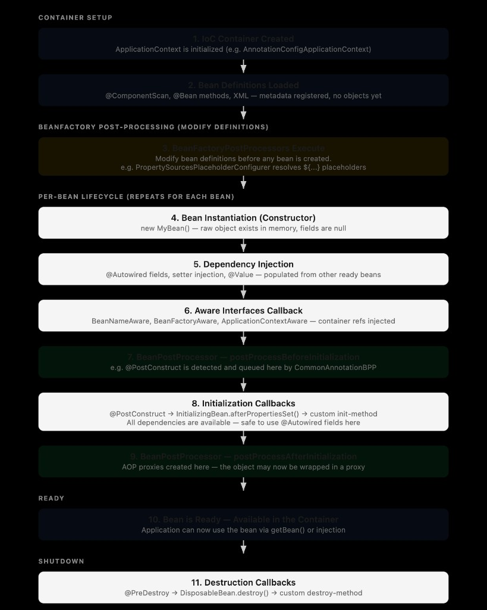
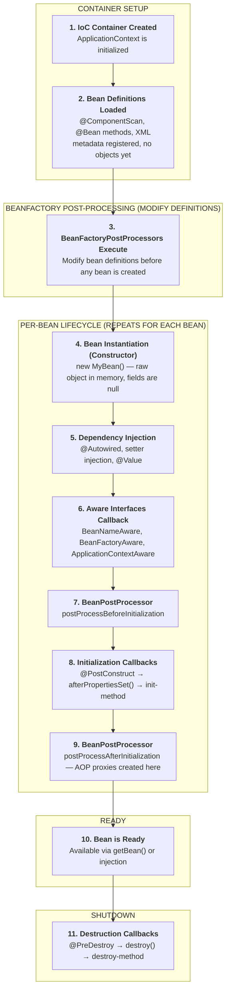

# Spring Bean Lifecycle Demo

A plain Spring (no Boot) project that prints all 11 steps of the bean lifecycle as they happen.

```sh
mvn -q compile exec:java
```

## The 11 steps





| # | Step | What happens | Where it is in this project |
|---|------|--------------|-----------------------------|
| 1 | IoC Container Created | `ApplicationContext` is initialized, e.g. `AnnotationConfigApplicationContext` | `MainApp.main()` |
| 2 | Bean Definitions Loaded | `@ComponentScan`, `@Bean` methods and XML are read. Metadata is registered — **no objects yet** | `AppConfig`, read by `context.register(...)` |
| 3 | BeanFactoryPostProcessors Execute | Bean *definitions* can be modified before any bean is created. The built-in `PropertySourcesPlaceholderConfigurer` resolves `${...}` here | `CustomBeanFactoryPostProcessor` |
| 4 | Bean Instantiation | The constructor runs. The raw object exists in memory but its fields are still null | `OrderService()`, `PaymentService()` |
| 5 | Dependency Injection | `@Autowired` fields, setter injection and `@Value` are populated from other already-ready beans | `OrderService.setPaymentService()` |
| 6 | Aware Interfaces Callback | Spring hands the bean references to itself: `BeanNameAware`, `BeanFactoryAware`, `ApplicationContextAware` | `OrderService.setBeanName()` / `setBeanFactory()` / `setApplicationContext()` |
| 7 | `postProcessBeforeInitialization` | Runs just before the init callbacks. This is where `CommonAnnotationBeanPostProcessor` detects and queues `@PostConstruct` | `CustomBeanPostProcessor` |
| 8 | Initialization Callbacks | `@PostConstruct` → `InitializingBean.afterPropertiesSet()` → custom `init-method`, in that order. All dependencies are available, so `@Autowired` fields are safe to use | `OrderService.postConstruct()` / `afterPropertiesSet()` / `customInit()` |
| 9 | `postProcessAfterInitialization` | Runs after the init callbacks. AOP proxies are created here, so the object may now be wrapped in a proxy | `CustomBeanPostProcessor` |
| 10 | Bean is Ready | The bean is in the container and the application can use it via `getBean()` or injection | `MainApp` calls `orderService.placeOrder(...)` |
| 11 | Destruction Callbacks | `@PreDestroy` → `DisposableBean.destroy()` → custom `destroy-method`, in that order | `OrderService.preDestroy()` / `destroy()` / `customDestroy()`, triggered by `context.close()` |

Steps 4 to 9 repeat for **every** bean. Steps 1 to 3 and 10 to 11 happen once for the container.

## Actual output

```
[STEP 1]  CONTAINER CREATED      : new AnnotationConfigApplicationContext()
[STEP 2]  DEFINITIONS LOADED     : register(AppConfig.class), 0 beans created so far
[STEP 3]  BEAN FACTORY POST PROC : postProcessBeanFactory(), 10 definitions, 0 beans created so far
[STEP 3]  BEAN FACTORY POST PROC : modified orderService definition (lazyInit = false)
[STEP 4]  INSTANTIATION          : PaymentService() constructor called
[STEP 7]  BEAN POST PROC BEFORE  : postProcessBeforeInitialization('paymentService')
[STEP 9]  BEAN POST PROC AFTER   : postProcessAfterInitialization('paymentService') — AOP proxies would be created here
[STEP 4]  INSTANTIATION          : OrderService() constructor called, paymentService = null
[STEP 5]  DEPENDENCY INJECTION   : setPaymentService() called by Spring, paymentService = ...PaymentService@257e1dff
[STEP 6]  AWARE                  : setBeanName('orderService')
[STEP 6]  AWARE                  : setBeanFactory()
[STEP 6]  AWARE                  : setApplicationContext()
[STEP 7]  BEAN POST PROC BEFORE  : postProcessBeforeInitialization('orderService')
[STEP 8]  INIT                   : @PostConstruct (runs 1st)
[STEP 8]  INIT                   : InitializingBean.afterPropertiesSet() (runs 2nd)
[STEP 8]  INIT                   : custom init-method customInit() (runs 3rd)
[STEP 9]  BEAN POST PROC AFTER   : postProcessAfterInitialization('orderService') — AOP proxies would be created here
[STEP 10] BEAN READY             : Order placed for 'Laptop' — Payment of $999.99 processed
[STEP 11] DESTROY                : @PreDestroy (runs 1st)
[STEP 11] DESTROY                : DisposableBean.destroy() (runs 2nd)
[STEP 11] DESTROY                : custom destroy-method customDestroy() (runs 3rd)
```

### Reading the output

`PaymentService` only shows steps 4, 7 and 9 because it implements no `Aware` interfaces and has no init or destroy hooks. `OrderService` is the bean that exercises every step.

`PaymentService` finishes its whole lifecycle before `OrderService` is even constructed. That is step 5 working as designed — a dependency is fully initialized before it is injected into anything.

`MainApp` builds the container in three calls instead of the usual one-liner:

```java
AnnotationConfigApplicationContext context = new AnnotationConfigApplicationContext();  // step 1
context.register(AppConfig.class);                                                      // step 2
context.refresh();                                                                      // steps 3-9
```

`new AnnotationConfigApplicationContext(AppConfig.class)` does all three at once, which would make steps 1, 2 and 3 impossible to tell apart. Splitting them is the only reason the output above is in order.

## Files

| File | Role |
|------|------|
| `MainApp.java` | Steps 1, 2, 10, 11 — drives the container |
| `config/AppConfig.java` | Step 2 — the bean definitions |
| `processor/CustomBeanFactoryPostProcessor.java` | Step 3 |
| `processor/CustomBeanPostProcessor.java` | Steps 7 and 9 |
| `service/OrderService.java` | Steps 4, 5, 6, 8, 11 — implements every hook |
| `service/PaymentService.java` | Step 4 — the injected dependency |
